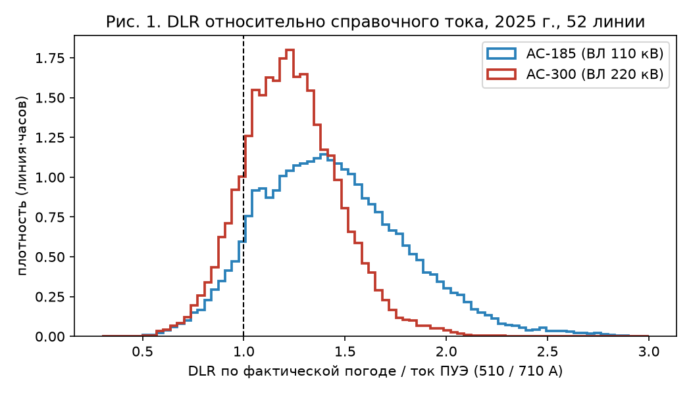
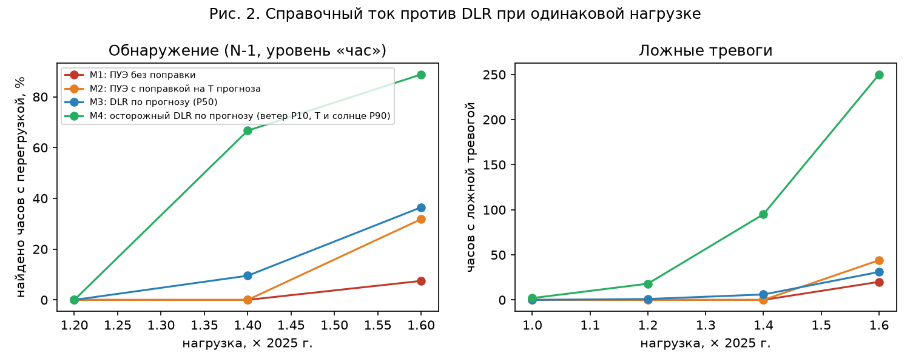

# Эксперимент A: справочный допустимый ток против DLR при одинаковой нагрузке

**Вопрос.** Насколько часто справочный ток ошибается относительно реального допустимого тока: ложные тревоги (метод видит перегрузку, которой нет) и скрытые риски (перегрузка есть, метод её не видит).

**Постановка.** Сеть `network_real.yaml` (110–220 кВ, состав генерации 2023 г.), 2025 г. по часам (68 цепей, нормальная схема и N-1 — 69 схем). «Правда» — DLR по фактической погоде (ERA5, ветер приведён к станциям, угол ветра по пролётам; шаг 3.3). Методы — по прогнозу на сутки:

- **M1** — ПУЭ без поправки
- **M2** — ПУЭ с поправкой на T прогноза
- **M3** — DLR по прогнозу (P50)
- **M4** — осторожный DLR по прогнозу (ветер P10, T и солнце P90)

Нагрузка 2025 г. — модель с зависимостью от температуры (допущение, `exp_a_load.py`: средняя 392, максимум 546 МВт); ×1,2–1,6 — условное утяжеление для проверки методов при перегрузках. Токи — на сетке нагрузки с интерполяцией; проверка без интерполяции — 0 расхождений из 12,4 млн решений (`check_exp_a_report.md`).

## Результаты (уровень «час»: была ли перегрузка в любой цепи при любой схеме N-1)

| нагрузка | часов с перегрузкой | метод | найдено | пропущено (скрытый риск) | ложных тревог |
|---|---|---|---|---|---|
| ×1.0 | 0 | M1 | 0 | 0 | 0 |
| ×1.0 | 0 | M2 | 0 | 0 | 0 |
| ×1.0 | 0 | M3 | 0 | 0 | 0 |
| ×1.0 | 0 | M4 | 0 | 0 | 2 |
| ×1.2 | 1 | M1 | 0 | 1 | 0 |
| ×1.2 | 1 | M2 | 0 | 1 | 0 |
| ×1.2 | 1 | M3 | 0 | 1 | 1 |
| ×1.2 | 1 | M4 | 0 | 1 | 18 |
| ×1.4 | 21 | M1 | 0 | 21 | 0 |
| ×1.4 | 21 | M2 | 0 | 21 | 0 |
| ×1.4 | 21 | M3 | 2 | 19 | 6 |
| ×1.4 | 21 | M4 | 14 | 7 | 95 |
| ×1.6 | 107 | M1 | 8 | 99 | 20 |
| ×1.6 | 107 | M2 | 34 | 73 | 44 |
| ×1.6 | 107 | M3 | 39 | 68 | 31 |
| ×1.6 | 107 | M4 | 95 | 12 | 250 |

## Наибольшая загрузка относительно допустимого тока метода (худшая цепь, худший час, N-1)

| нагрузка | «правда» | M1 | M2 | M3 | M4 |
|---|---|---|---|---|---|
| ×1.0 | 0.80 | 0.53 | 0.60 | 0.80 | 1.04 |
| ×1.2 | 1.00 | 0.67 | 0.76 | 1.00 | 1.30 |
| ×1.4 | 1.23 | 0.84 | 0.95 | 1.22 | 1.58 |
| ×1.6 | 1.51 | 1.10 | 1.23 | 1.48 | 1.92 |

## Уровень «линия·схема·час» при ×1,6 (в скобках — жаркие часы, ERA5 ≥ 35 °C; штиль < 1 м/с)

| метод | найдено | ложных | скрытых | скрытых в жару | скрытых в штиль |
|---|---|---|---|---|---|
| M1 | 15 | 41 | 869 | 406 | 574 |
| M2 | 64 | 92 | 820 | 379 | 568 |
| M3 | 139 | 340 | 745 | 394 | 496 |
| M4 | 381 | 5558 | 503 | 286 | 414 |

## Выводы

1. При нагрузке 2025 г. перегрузок нет ни по одному методу и ни по «правде» (сеть `network_real` загружена слабо). Но **справочный ток почти вдвое переоценивает запас**: наибольшая загрузка по ПУЭ — 0,53 (0,60 с поправкой на температуру) при 0,80 относительно фактического допустимого тока.
2. При утяжелении справочный ток (M1, M2) **систематически пропускает реальные перегрузки**: при ×1,4 — все 21 час, при ×1,6 находит 8 (M1) и 34 (M2) из 107. Ложных тревог у него мало — его ошибка односторонняя (скрытый риск), потому что при штиле и жаре реальный допустимый ток ниже табличного.
3. DLR по медиане прогноза (M3) тоже пропускает большую часть (2 из 21; 39 из 107): ошибка прогноза ветра и температуры симметрична, а перегрузка возникает в худших часах.
4. Осторожный DLR (M4: ветер P10, температура и солнце P90) находит почти всё (14 из 21; 95 из 107), но ценой ложных тревог (95 и 250 часов) — это плата за неопределённость прогноза; её можно уменьшать уровнем квантиля.

## Ограничения

- «Правда» — DLR по реанализу ERA5 с поправкой ветра к станциям, а не измерения на линиях; ERA5 занижает жару в Актау (шаг 2.1) — реальных опасных часов, вероятно, больше.
- Нагрузка 2025 г. — модель (почасовых данных нет); утяжеление ×1,2–1,6 — условное.
- Сеть — только линии с тегом 110/220 кВ в OSM; провода — допущения (АС-185 / АС-300), ε и α — допущения.
- Погода — три точки; до части линий 80–190 км.
- Токи посчитаны при +25 °C в проводе (влияние температуры на сопротивление на токи мало).
