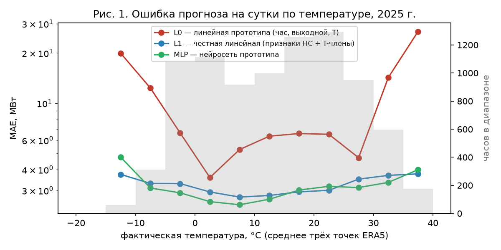
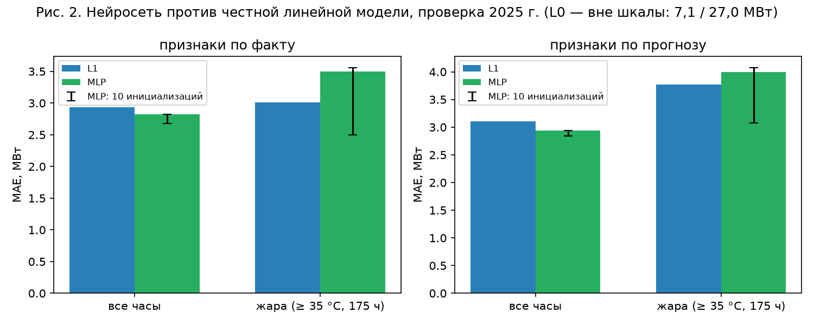

# Эксперимент B: нейросеть против линейной модели на независимом периоде

**Вопрос.** Даёт ли нейросеть выигрыш перед линейной моделью прогноза нагрузки на независимом периоде — во всех часах и в жаркие часы?

**«Правда».** Реальной почасовой нагрузки нет. Нагрузка — генератор прототипа `trueLoad` (промышленность, быт с профилем, коммерция, кондиционирование с квадратичным ростом выше 30 °C, отопление, шум AR(1)) на **реальной погоде** ERA5 2023–2025 (среднее трёх точек). Это синтетика: выводы касаются методов, а не нагрузки Мангистау.

**Обучение** — 2023–2024 (17542 ч, признаки по факту), **проверка** — 2025: по факту и по прогнозу на сутки (Open-Meteo, выпуск накануне). Жара — фактическая T ≥ 35 °C (175 ч). Перенос моделей на Python совпадает с JS-прототипом (`check_exp_b_port_report.md`).

- **L0** — L0 — линейная прототипа (час, выходной, T)
- **L1** — L1 — честная линейная (признаки НС + T-члены)
- **MLP** — MLP — нейросеть прототипа

## Признаки по факту (качество модели)

| модель | MAE, МВт | MAPE, % | RMSE | жара: MAE | жара: MAPE, % | жара: смещение |
|---|---|---|---|---|---|---|
| L0 | 7.07 | 5.13 | 9.09 | 26.96 | 15.36 | +26.96 |
| L1 | 2.94 | 2.20 | 3.68 | 3.01 | 1.74 | -0.68 |
| MLP | 2.83 | 2.12 | 3.55 | 3.50 | 1.98 | +3.12 |

MLP по 10 инициализациям: MAE 2.68…2.83; в жару 2.50…3.56 МВт.

| сравнение | ΔMAE (все), МВт [95 % ДИ] | DM p | ΔMAE (жара) [95 % ДИ] | p |
|---|---|---|---|---|
| MLP−L1 | -0.108 [-0.204; -0.012] | 0.025 | +0.491 [-0.624; +1.776] | 0.29 |
| MLP−L0 | -4.243 [-4.545; -3.930] | 1.5e-164 | -23.459 [-24.106; -22.843] | 0 |

## Признаки по прогнозу на сутки (эксплуатация)

| модель | MAE, МВт | MAPE, % | RMSE | жара: MAE | жара: MAPE, % | жара: смещение |
|---|---|---|---|---|---|---|
| L0 | 7.07 | 5.13 | 9.09 | 26.96 | 15.37 | +26.96 |
| L1 | 3.11 | 2.32 | 3.91 | 3.77 | 2.17 | -0.25 |
| MLP | 2.94 | 2.20 | 3.69 | 4.00 | 2.27 | +3.52 |

MLP по 10 инициализациям: MAE 2.84…2.94; в жару 3.08…4.08 МВт.

| сравнение | ΔMAE (все), МВт [95 % ДИ] | DM p | ΔMAE (жара) [95 % ДИ] | p |
|---|---|---|---|---|
| MLP−L1 | -0.166 [-0.257; -0.073] | 0.00063 | +0.225 [-0.996; +1.505] | 0.7 |
| MLP−L0 | -4.131 [-4.422; -3.829] | 2.6e-158 | -22.969 [-23.822; -22.127] | 0 |

## Выводы

1. **Преимущество нейросети в прототипе — в основном заслуга слабой линейной модели.** Линейная модель прототипа (L0) почти не зависит от температуры (наклон 0,02 МВт/°C: рост в жару и в холод гасят друг друга) — в жару её ошибка 27 МВт (15 %). Честная линейная модель (L1) с теми же признаками и простыми температурными членами сокращает ошибку в 2,4 раза по всем часам и в 9 раз в жару.
2. **Против честной линейной модели нейросеть выигрывает немного:** 0,11 МВт (4 %) по факту и 0,17 МВт (5 %) по прогнозу; разница статистически значима, но сравнима с разбросом самой нейросети по инициализациям (0,10–0,15 МВт).
3. **В жару устойчивого выигрыша нет:** нейросеть с инициализацией прототипа хуже L1 на 0,2…0,5 МВт (незначимо) и систематически занижает нагрузку в жару (смещение +3,1…3,5 МВт), а линейная модель с квадратичным членом — почти без смещения. По 10 инициализациям MAE нейросети в жару 2,50…3,56 МВт (по факту) против 3,01 у L1 — то лучше, то хуже: в жару результат определяется случайной инициализацией. Для задачи «риск в жаркие часы» это главное.
4. Ошибка прогноза погоды добавляет 0,1–0,8 МВт к MAE (больше всего — в жару): вклад погоды сравним с разницей между моделями.

## Ограничения

- «Правда» — генератор с известной структурой; честная линейная модель получила члены, похожие на генератор (порог 24 °C, квадрат выше 30 °C) — на реальной нагрузке структура неизвестна, и выигрыш гибкой модели может быть больше. Вывод «нейросеть не нужна» на реальные данные переносить нельзя.
- Один год проверки; жарких часов 175; в 2025 г. нет температур выше максимума обучения (39,9 °C) — проверки экстраполяции нет.
- Температура — среднее трёх точек; нейросеть — архитектура прототипа без подбора.
